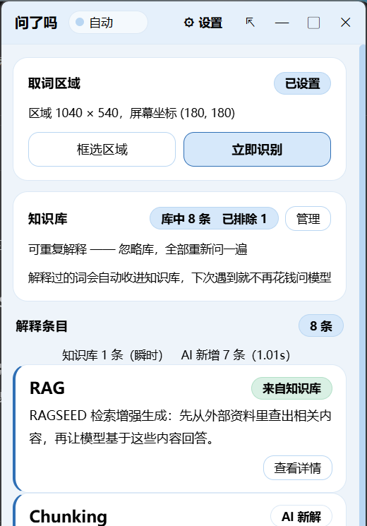

# 问了吗

> ask-me-please —— 一块常驻屏幕侧边的窄栏。读笔记时被英文术语卡住，不用切窗口去搜，框一下或者选中按个键，它把解释贴在你手边。



---

## 它解决的是什么

读英文资料、行业报告、技术文档的时候，真正让人停下来的不是整段读不懂，而是**一个词卡住**：

> "……这块要做 **Chunking** 和 **Embedding**……"

你知道上下文在讲什么，但 Chunking 具体指什么、和 Embedding 什么关系，脑子里是糊的。于是切窗口 → 开浏览器 → 搜 → 翻三个结果 → 回来，**原来的思路断了**。

一次 30 秒，一页笔记打断七八次。大多数人最后的选择是不查了，囫囵读过去。

**问了吗做的事**：把这一步压到 2 秒。屏幕右边常驻一条窄栏，你不用离开笔记，框一下、或者选中按 `Ctrl+E`，解释就以卡片形式贴在侧边。**解释过的词自动进本地知识库，下次遇到直接贴出来，不再花钱问模型。**

---

## 三种取词方式

| 通道 | 怎么触发 | 认什么 |
|---|---|---|
| **框选** | 框一块区域 → 点「立即识别」 | 只认英文 |
| **自动** | 打开标题栏的「自动」开关，**画面停住满 15 秒**它自己跑一遍 | 只认英文 |
| **快捷键** | 在飞书 / Obsidian 里选中一段文字，按 `Ctrl+E` | **中英不限** |

自动通道的设计有个反复调过的点：它**只看画面稳不稳定**，不看"你有没有在动键鼠"。早先两个条件叠加时几乎永远不触发 —— 因为读笔记的节奏是「滚一屏 → 读二三十秒 → 再滚」，「整整 60 秒没碰键鼠」在主路径上根本不成立。延迟的是**执行**而不是渲染，只为「你真正停下来看的那一屏」花钱。

快捷键通道借一下剪贴板把选中的字取走，**用完原样还回去**；剪贴板里要是图片或文件（不是文字），它就不动手，免得弄丢你的东西。

---

## 核心：三段管线

```
① 规则初筛（本地正则）  →  捞出英文词块候选
③ 知识库过滤（本地）    →  命中的直接贴，不花钱
② AI 单次调用           →  筛选 + 生成解释
```

⚠️ **①②③ 是三段的编号，不是执行顺序 —— 实际执行是 ① → ③ → ②。**

③ 必须跑在 ② 前面：库里已经有的词**不进 ② 的候选表**。反过来就白做了，钱已经花了。

② **只调用一次**，同一次调用同时完成「挑哪些词值得解释」和「给每个词写一句解释」。不拆成「先挑术语、再逐个解释」两阶段 —— 那是 N+1 次调用。

知识库有三个策略，问的是同一个问题的三档：**「库里那条旧解释，你打算拿它怎么办？」**

| 策略 | 库里命中 | 库里没命中 |
|---|---|---|
| `不重复解释`（默认） | 直接贴存的，标「来自知识库」，不进 ② | 正常走 ② |
| `可重复解释` | 忽略库，全部交给 ② | 正常走 ② |
| `只解释库内` | 贴存的 | **整个不出现** |

---

## 跑起来

**环境**：Windows 11 + Python 3.14。界面跑在系统自带的 WebView2 上（不打包 Chromium），窗口摆放、剪贴板、DPAPI 都直接走 Win32 —— **目前只有 Windows 版本**。

```bash
git clone https://github.com/<你的用户名>/ask-me-please.git
cd ask-me-please
pip install -r requirements.txt
python app/main.py
```

首次启动后，点标题栏的齿轮进**操作台**，填入自己的 DeepSeek API Key（`接入`）。Key 用 Windows DPAPI 加密后落盘，**绑死这台机器 + 这个 Windows 用户** —— 换机器要重新填一次。

> ⚠️ **隐私**：笔记里的文字会发送给 DeepSeek 做解释。OCR 环节全本地，不外传；截图在识别完就删，不留盘。首次使用会有明确告知。

> ⚠️ **成本**：定时截屏 + 频繁调模型会产生费用。两道防线 —— ① **同一屏只跑一次** ② **知识库去重（同一个词永远只花一次钱）**。规则初筛只是少花，不算防线。

---

## 工程上值得一提的

这个项目是**和 AI 结对写出来的**，所以真正花力气的地方不是功能，是**怎么让 AI 写出来的东西可信**。规矩都写在 [`CLAUDE.md`](CLAUDE.md) 里，几条最硬的：

- **新加一条断言跑绿不算数 —— 给它配的变体不红，它就是装饰品。** 每条断言都要能被人为弄红一次，否则你根本不知道它接没接上。
- **一个不生效的检查，和一个通过的检查，长得一模一样。** 这条规矩抓到过一个真事故：`.gitignore` 写了一行带行尾注释的规则，git 把整串（含 `#` 和后面的字）当成文件名，**一条都匹配不上，而且不报错** —— `git add -A` 照样把真 Key staged 了。
- **检查的覆盖面小于结论的覆盖面，就是把「没检查」伪装成「检查过了」。** 回归脚本曾经一边打 `✓ 数据安全`，一边把用户唯一的 API Key 覆盖成了测试假值。
- **全绿的记分卡要先审问再相信。** 100 条断言一路绿，逐条倒出明细才发现头号失败模式被漏判了。
- **判据不能建在一句话上，也不能建在产品自己说的数上。** 前者会被第二个引用者污染，后者是自证 —— 产品说到做到，不代表它说的是对的。

项目里现阶段有 **10 个回归脚本 / 563 项断言**，外加若干一次性探针。跑法：

```bash
python 冒烟测试/全部回归.py
```

验证过程、每一次踩坑的来龙去脉、以及 59 项已拍板的产品决策，都在 [`进展文档.md`](进展文档.md)（含附录 A~O）。测试用例设计在 [`测试用例50条.md`](测试用例50条.md) —— 那批贴着**用户的一天**验，和贴着代码验的回归是两回事。

---

## 已知边界

- **只做英文术语**（快捷键通道除外）。中文行业黑话排在第三期，没有实现，也没有为它预留过度复杂的设计。
- **不做联网搜索**。它要第二把 Key、第二笔钱，和「只支持 DeepSeek 一个厂商」直接冲突 —— 这个取舍在 `进展文档.md` 里有逐页核对过的记录。
- **不翻译全文、不做摘要、不做全文问答。** 它只回答「这个词是什么意思」。
- ⚠️ **有一环至今没验过**：真实模型对这份 System Prompt 的服从度、筛得准不准。**链路那一半验完了**（263 项断言证明「模型照办时，整条能一路走到屏幕上」），**缺的是模型那一半** —— 那要拿真 Key 跑真实数据，会产生真实费用，所以一直没跑。别把这一版当成「已经验过了」。

---

## License

[MIT](LICENSE)
